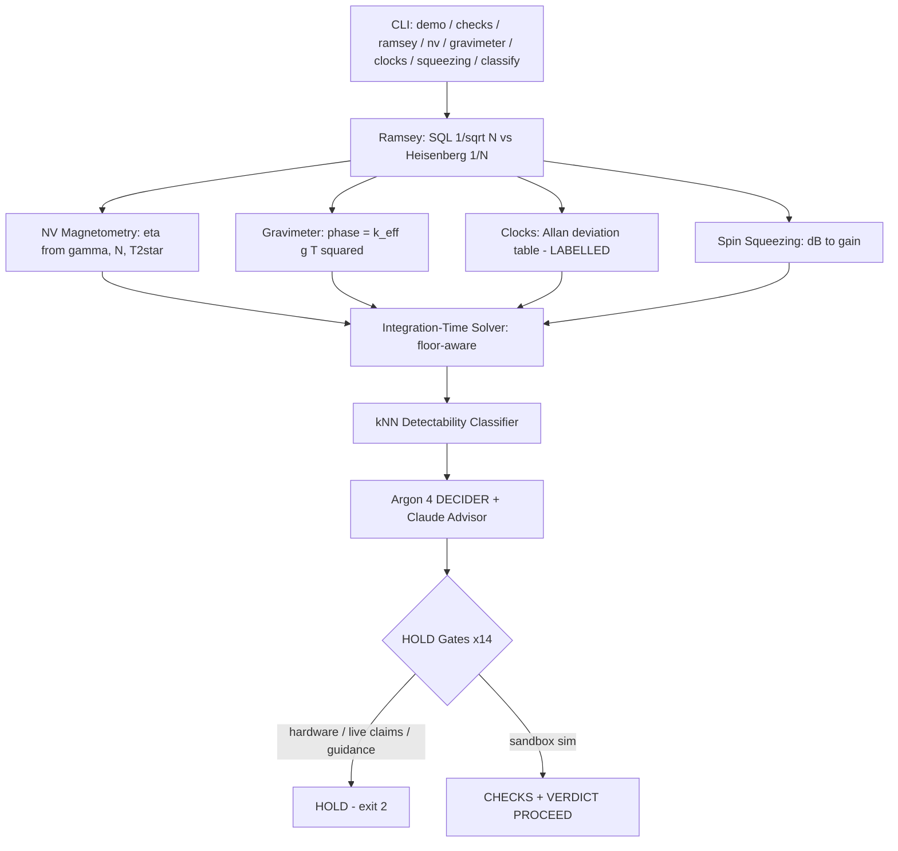
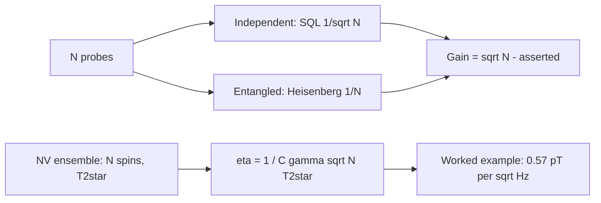
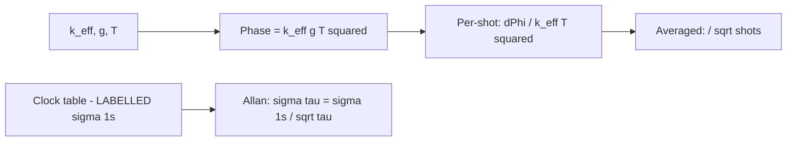
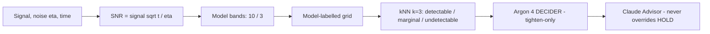
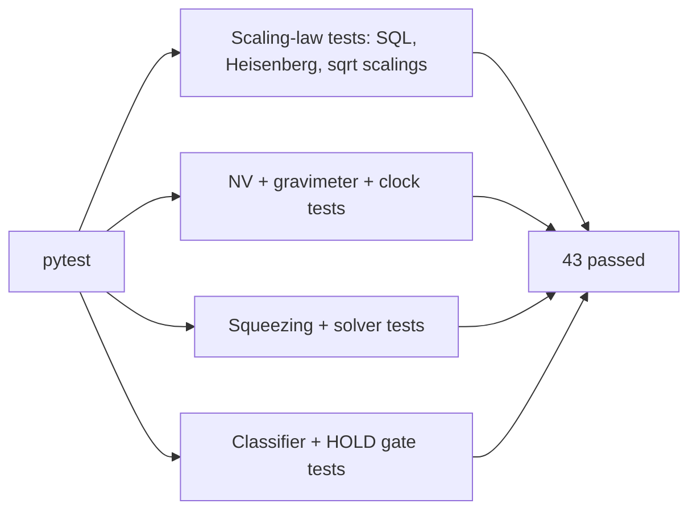
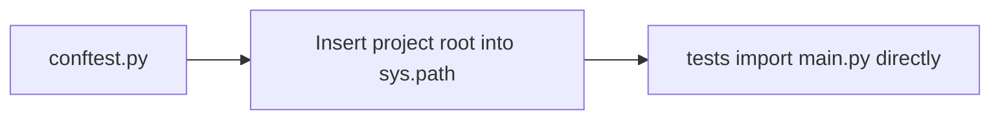
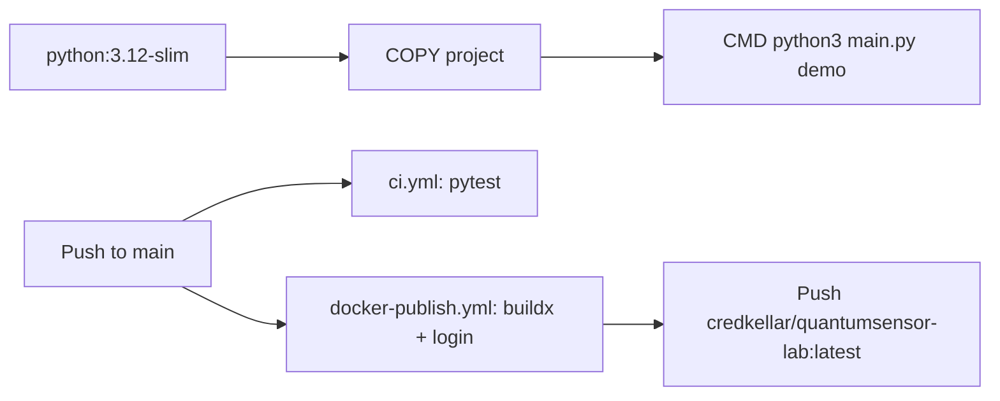

# QuantumSensor-Lab 📡⚛️

**Quantum Sensing Lab** — by Darion Kellar

QuantumSensor-Lab is an **educational quantum sensing lab** in ONE pure-Python file. It teaches the one idea underneath every quantum sensor — **sensitivity is a scaling law** — by computing the laws instead of quoting them:

- **Independent probes** average down as **1/√N** — the standard quantum limit (SQL).
- **Entangled probes** can in principle reach **1/N** — the Heisenberg limit — and the lab asserts *both* scalings numerically, including the exact gain factor √N.
- Everything else is the same lesson in different clothes: NV magnetometry buys sensitivity as √(N·T2*), a gravimeter's phase grows as T², a clock's Allan deviation falls as 1/√τ, and squeezing trades variance for a √-gain.

The lab covers Ramsey interferometry phase estimation, an NV-center magnetometry sensitivity model with labelled constants, an atom-interferometer gravimeter (phase = k_eff · g · T²), an Allan-deviation atomic-clock table (every row a **LABELLED** published-class reference), spin squeezing, an integration-time solver that *refuses* unreachable targets, and a from-scratch kNN detectability classifier whose labels are generated by the sensitivity model itself. 🔬

Honest scope, stated up front: **nothing here measures anything.** No sensor is operated, no field is read, no clock is timed. Every number is a model value computed from a stated formula, or a labelled published-class reference printed for scale. Every real-hardware / live-measurement / navigation / weapons-guidance claim sits behind a permanent HOLD gate (14 total). 🔒

[](https://github.com/kimanicollier44-cmyk/QuantumSensor-Lab/actions/workflows/ci.yml)
[](https://github.com/kimanicollier44-cmyk/QuantumSensor-Lab/actions/workflows/docker-publish.yml)

> ℹ️ These are the **live** workflow badges for this repo. They activate as soon as the `ci.yml` and `docker-publish.yml` files from the paste pack are pasted into `.github/workflows/` — until then they have nothing to report yet.

## 🧰 Tech Stack Badges & Full Architecture Tech Stack

### 💻 Core Programming Languages & Core Systems


- 🐍 Python 3.12, pure standard library (`math`, `hashlib`, `json`, `sys`) — zero dependencies, zero network, deterministic (double-run byte-identical)
- 📐 Sensing core: Ramsey SQL `1/√N` vs Heisenberg `1/N` (both asserted numerically), NV sensitivity `η = 1/(C·γ·√(N·T2*))`, gravimeter phase `k_eff·g·T²`, Allan deviation `σ(τ) = σ₁/√τ`, squeezing gain `10^(dB/20)` — every formula checked against its analytic value in CHECKS
- 🧠 TinyML kNN detectability classifier (from scratch, stdlib): detectable / marginal / undetectable from (signal, noise floor, integration time); training grid labelled by the sensitivity model itself
- 🪑 Council seats: Gemini Argon 4 DECIDER (names-only, tighten-only) + Muse advisor (never overrides HOLD) + Google Flow plan-only (rendered = False, live = 0)

### ⛓️ Web3 & Infrastructure

- 🚫 **Not applicable — honestly.** No blockchain, no Web3, no tokens: the "infrastructure" in this lab is a set of sensitivity models inside one offline file. No fake badges here.

### ⚙️ Platform Support & Hardware Architecture


- 🖥️ Pure Python — runs anywhere Python 3.12+ runs (Linux, macOS, Windows), plus the `python:3.12-slim` Docker image
- 🔒 No hardware is controlled, ever: real sensors, lasers, vacuum systems, and clocks are permanent HOLD gates (see the gate table below)

### ⚡ Low-Level Infrastructure & Performance

- 🚫 **No low-level code — honestly.** No C, no C++, no GPU, no compiled extensions: this is one interpreted Python file on purpose, so every number can be read, checked, and diffed. Performance here means honest closed-form models — the Ramsey / NV / gravimeter / Allan formulas are all analytic, and the classifier's model-labelled grid is built once at import.

### 🛠️ DevOps & Build Tools


- 🐳 Docker (`python:3.12-slim`), GitHub Actions CI + Docker Publish (delivered in the paste pack)
- 🎯 Target image: `credkellar/quantumsensor-lab:latest`
- 🧪 Tests: `pytest` (43 tests) + the built-in CHECKS suite (49 checks) in `main.py`

### ☁️ Cloud Providers

- 🚫 **None — honestly.** No cloud provider is used or needed: the lab runs fully offline on your own machine or in a local Docker container. Docker Hub appears only as the registry the publish workflow pushes the image to.

## What this does?

1. 🎯 **Ramsey interferometry — the two scaling laws** — phase uncertainty for N probes at the SQL (`1/√N`) and at the Heisenberg limit (`1/N`), tabulated for N = 1 → 10,000. At N = 100: **0.1000 rad vs 0.0100 rad**. The checks assert the Heisenberg value *is* the SQL squared and the entanglement gain *is* exactly √N — the laws are proven in the test suite, not asserted in prose.
2. 💎 **NV-center magnetometry** — ensemble sensitivity `η = 1/(C·γ·√(N·T2*))` with the electron gyromagnetic ratio γ = 28.024 GHz/T (**LABELLED** published constant) and a labelled readout efficiency C = 0.01. Worked example — N = 10¹² spins, T2* = 1 µs: **η = 5.679×10⁻¹³ T/√Hz ≈ 0.57 pT/√Hz**, printed with every input named.
3. 🌍 **Atom-interferometer gravimeter** — phase `φ = k_eff · g · T²` with k_eff = 1.611×10⁷ rad/m (**LABELLED**, Rb-87 Raman): at T = 0.1 s the phase is **1.580×10⁶ rad**, and SQL phase noise over 10⁶ atoms gives a per-shot sensitivity of **6.21×10⁻⁹ m/s² (0.62 µGal)**, improving to 6.21×10⁻¹⁰ after 100 shots.
4. 🕰️ **Atomic clocks** — Allan deviation `σ(τ) = σ₁/√τ` over a three-row table — rubidium oscillator class (σ₁ = 2.0×10⁻¹¹), cesium fountain class (3.0×10⁻¹³), strontium optical lattice class (2.0×10⁻¹⁶) — every row flagged **LABELLED published-class reference, never measured here**. At τ = 10⁴ s the Sr class reaches 2.0×10⁻¹⁸.
5. 🗜️ **Spin squeezing** — decibels converted honestly: variance factor `10^(dB/10)`, sensitivity gain its square root. **10 dB → variance ÷10 → gain 3.16×** (not 10×); 20 dB → gain 10×. The squeezed Ramsey uncertainty is the SQL divided by the gain, asserted in CHECKS.
6. ⏱️ **Integration-time solver** — inverts the averaging law with a noise floor: `t = η² / (target² − floor²)`. The NV example reaches 1×10⁻¹³ T in **32.3 s** with no floor — and with a 2×10⁻¹³ T floor the same target is **unreachable**: the solver returns `None` and says why, instead of printing a fantasy number.
7. 🏷️ **Detectability classifier** — a from-scratch kNN over (log signal, log noise, log time) whose ~4,900-row training grid is labelled by the model's own SNR bands (SNR ≥ 10 detectable, ≥ 3 marginal, else undetectable). A 1 pT field against the NV example's noise is *undetectable* in 1 s and *detectable* after 10⁴ s — the classifier and the model agree on every scenario, asserted in CHECKS.
8. 🪑 **Council seats + HOLD gates** — Gemini Argon 4 DECIDER (names-only, tighten-only, sha256 trace), Muse advisor (`can_override_hold = False`), Google Flow plan-only (`rendered = False`, `live = 0`), and 14 permanent HOLD gates: real hardware, live-measurement claims, navigation and weapons guidance, GPS-replacement claims, and more.

## 🗺️ How it works — diagram per script

### `main.py` — the whole lab



### `main.py` — Ramsey + NV subsystem



### `main.py` — gravimeter + clocks subsystem



### `main.py` — classifier + council subsystem



### `tests/test_main.py` — verification



### `conftest.py` — test path setup



### `Dockerfile` + CI flow — container & publish



## Why is this cool?

1. 🎯 The two most quoted limits in quantum metrology are **proven in the test suite**: Heisenberg = SQL² and gain = √N are asserted numerically, not name-dropped.
2. 💎 The NV worked example shows its whole hand — γ, N, T2*, and the readout efficiency C are all printed, so the 0.57 pT/√Hz figure can be recomputed by anyone.
3. 🌍 The gravimeter's T² law is visceral once computed: the phase is **1.58 million radians**, and doubling the drop time quarters the per-shot error before any averaging.
4. 🕰️ Three clock classes on one Allan slope make five orders of magnitude tangible: Rb 2×10⁻¹¹ → Sr 2×10⁻¹⁶ at 1 s, each row honestly flagged as a labelled class reference.
5. 🗜️ Squeezing is demystified into arithmetic: 10 dB is a 3.16× gain, and the lab shows exactly why (gain = √variance factor).
6. ⏱️ The solver **refuses**: a target below the noise floor returns `None` with the reason attached — the rarest feature in sensitivity calculators.
7. 🏷️ The classifier's labels come from the physics model itself, so the TinyML layer can be *audited* against the formulas — and the checks do exactly that.
8. 🧮 One file, zero dependencies: the entire lab — interferometry, magnetometry, gravimetry, clocks, squeezing, solver, classifier — runs on a stock Python install, offline.
9. 🔒 The HOLD gates name the real-world claims people actually make with sensor math (navigation, guidance, GPS replacement) and hold every one of them, permanently, with exit code 2.
10. 🎯 Deterministic end to end: run it twice, get byte-identical output — a sensing lab you can diff.

## What problems this solves?

1. ❌ **Problem:** "Heisenberg limit" is usually invoked as a buzzword. ✅ **Solution:** Both scalings are computed side by side and the √N gain is asserted in CHECKS and pytest.
2. ❌ **Problem:** NV sensitivity figures get quoted without their assumptions. ✅ **Solution:** The model prints γ, N, T2*, and the labelled efficiency C next to the result — change any input and the √-scaling shows.
3. ❌ **Problem:** Gravimeter sensitivity claims hide the interrogation time. ✅ **Solution:** Phase and per-shot sensitivity are computed from k_eff·g·T² with T explicit, and the T² advantage is a checked property.
4. ❌ **Problem:** Clock specs mix measured records with class figures. ✅ **Solution:** Every table row carries a `labelled` flag and the README/demo say "published-class reference, not measured" wherever the numbers appear.
5. ❌ **Problem:** "10 dB of squeezing" gets read as "10× better". ✅ **Solution:** The dB → variance → gain chain is computed step by step: 10 dB → 3.16×.
6. ❌ **Problem:** Averaging calculators promise any sensitivity given enough time. ✅ **Solution:** The solver includes a noise floor and returns `None` for unreachable targets.
7. ❌ **Problem:** "Detectable" is usually a vibe. ✅ **Solution:** Detectability is an SNR computed from the sensitivity model, with named bands (10 / 3) and a classifier that must agree with the model.
8. ❌ **Problem:** Sensor explainers quietly imply a product or a measurement. ✅ **Solution:** 14 named HOLD gates return exit code 2 for hardware operation, live-measurement, navigation, guidance, and commercial claims.
9. ❌ **Problem:** Quantum-sensing material is scattered across five subfields with five notations. ✅ **Solution:** One file, one notation: probes, coherence, integration time — the same three currencies priced in every section.
10. ❌ **Problem:** Simulation tools need installs, keys, and network. ✅ **Solution:** Pure stdlib, zero dependencies, zero network — clone and run.

## How to install this?

1. 📥 Clone the repo:

```bash
git clone https://github.com/kimanicollier44-cmyk/QuantumSensor-Lab.git
cd QuantumSensor-Lab
```

2. 🐍 Make sure Python 3.12+ is installed: `python3 --version`
3. ▶️ Run the full demo + checks (no arguments needed):

```bash
python3 main.py
```

4. 🧪 Run the test suite:

```bash
pip install pytest
python3 -m pytest -q
```

5. 🎛️ Try the other commands:

```bash
python3 main.py checks      # 49 built-in checks
python3 main.py ramsey      # SQL vs Heisenberg table
python3 main.py nv          # NV magnetometry worked example
python3 main.py gravimeter  # phase + per-shot sensitivity
python3 main.py clocks      # Allan deviation table (LABELLED)
python3 main.py squeezing   # dB -> variance factor -> gain
python3 main.py classify    # kNN detectability report
python3 main.py brains      # Argon 4 + Muse + Flow seats
python3 main.py holds       # list all 14 HOLD gates
python3 main.py hold-demo   # exits 2 - gated actions stay HOLD
```

6. 🐳 Or run it in Docker:

```bash
docker pull credkellar/quantumsensor-lab:latest
docker run --rm credkellar/quantumsensor-lab:latest
```

…or build the image yourself:

```bash
docker build -t credkellar/quantumsensor-lab:latest .
docker run --rm credkellar/quantumsensor-lab:latest
```

## Requirements

- 🐍 Python 3.12 or newer
- 📦 Dependencies: **none** (standard library only)
- 🌐 Network: **none** — fully offline
- 🧪 For tests only: `pytest`
- 🐳 Optional: Docker

## FULL project structure tree

```text
quantumsensor-lab/
├── main.py                  # the whole lab: Ramsey SQL/Heisenberg, NV magnetometry, gravimeter, clocks, squeezing, solver, classifier, seats, HOLD gates
├── conftest.py              # puts the project root on sys.path for tests
├── tests/
│   └── test_main.py         # 43 pytest tests: scaling laws, NV, gravimeter, clocks, squeezing, solver, classifier, gates, determinism
├── assets/
│   └── cover.png            # README cover image (2736 x 912)
├── Dockerfile               # python:3.12-slim, runs the demo
├── .gitignore               # __pycache__/, .pytest_cache/, *.pyc
└── README.md                # this file
```

> 📦 Delivered separately as paste packs (not in this tree): `.github/workflows/ci.yml` + `docker-publish.yml`, and the Docker Hub pack (100-char description, 350-char About, overview, categories).

## 🔒 HOLD gates — all 14, permanent

| # | Gate | What stays held |
|---|------|-----------------|
| 1 | `real_hardware_operation` | No operating any real quantum sensor, magnetometer, gravimeter or clock |
| 2 | `live_measurement_claim` | No live measurement claims; every number is a model value or a labelled published reference |
| 3 | `navigation_guidance_claim` | No navigation guidance of any vehicle, vessel or person from these models |
| 4 | `weapons_guidance_claim` | No weapons guidance, targeting or fire-control use of any kind |
| 5 | `subsurface_targeting_claim` | No claims of locating hidden structures, bunkers or resources with sensor models |
| 6 | `medical_diagnosis_claim` | No medical diagnosis claims; NV magnetometry models diagnose nothing |
| 7 | `surveillance_claim` | No surveillance or monitoring of people with sensor models |
| 8 | `calibration_service_claim` | No real instrument calibration service; this lab calibrates nothing |
| 9 | `certified_accuracy_claim` | No certified accuracy claims; model values are not metrology certificates |
| 10 | `gps_replacement_claim` | No claim that quantum sensors replace GPS or any fielded navigation system |
| 11 | `commercial_service_claim` | No commercial sensing service; this is an educational simulator |
| 12 | `guaranteed_sensitivity_claim` | No guaranteed real-world sensitivity; floors, drift and systematics are not in this model |
| 13 | `live_experiment` | No live experiment instructions on real hardware; this lab computes, it does not operate |
| 14 | `investment_claim` | No investment advice about quantum sensing companies or products |

🧑‍⚖️ **Council seats:** Gemini Argon 4 Extended Thinking — DECIDER (names-only, tighten-only, MAP → MODEL → STRESS → DECIDE, sha256 trace, `can_override_hold = False`) · Muse — advisor (`can_override_hold = False`) · Google Flow — plan-only (`rendered = False`, `live = 0`).

✅ **Verification:** pytest **43 passed** (project + clean copy) · built-in CHECKS **49/49** · double-run output **byte-identical** · `hold-demo` exits **2** · `main.py` **694 lines**, pure stdlib, zero network.

## 🧒 5th-grade English section

Imagine you are trying to hear a tiny whisper in a noisy room. 🤫

- One person listening can only hear so much. If **100 people** listen and share notes, the whisper gets clearer — but only **10 times** clearer, not 100. That is the **standard quantum limit**: more helpers help, but with a square root, and square roots are stingy. 👂
- Now imagine the 100 listeners are all holding hands and listening as **one giant ear**. Then the whisper can get the full **100 times** clearer. That is the **Heisenberg limit** — the best physics allows — but the giant ear falls apart if anyone lets go, which is why it is so hard in real life. 🤝
- A **diamond sensor** uses tiny broken spots inside a diamond that spin like compass needles. Line up a trillion of them, keep them spinning calmly for longer, and they can feel magnetic fields far too weak for any normal compass. 💎
- A **gravity sensor** drops a cloud of atoms and watches the wave pattern it makes, like ripples crossing in a pond. The longer the atoms fall, the bigger the pattern — and gravity writes its strength into the pattern. 🌍
- **Clocks** here are compared by how much their ticking wobbles when you watch them for longer and longer. The best class of clock in the lab wobbles about **100,000 times less** than the simplest one. 🕰️
- **Squeezing** is like squishing a balloon: push the wobble down on one side and it bulges out the other side. You win on the side you measure — just not by as much as the headline number suggests. 🎈
- This project is a **pretend lab on a computer**. It measures nothing real. It teaches you the math rules that every real quantum sensor has to obey. 💻

---

MIT © 2026 Darion Kellar · QuantumSensor-Lab — educational simulation only 📡
